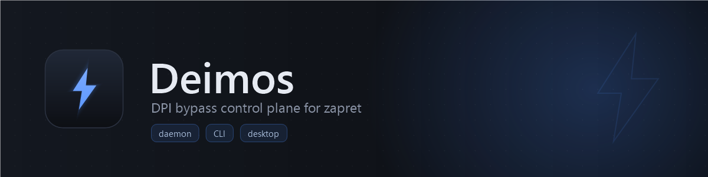

# Deimos

[](https://github.com/ToshiNamura/Deimos/actions/workflows/ci.yml)
[](LICENSE)
[](CMakeLists.txt)



Deimos is a cross-platform control plane for DPI bypass on top of
[zapret](https://github.com/bol-van/zapret) and [zapret2](https://github.com/bol-van/zapret2).

It splits the problem into two programs:

| Program | Role |
| --- | --- |
| `deimosd` | Headless daemon. Owns the zapret processes, applies profiles, serves the management API. Runs locally, on a router, or on a VPS. |
| `deimos` | One client binary: opens the desktop interface when started without arguments, and behaves as a full command line client when given a command. |

The daemon and the client speak plain HTTP + JSON with a bearer token, so the same UI and
CLI manage a daemon on `127.0.0.1` and a daemon on a remote server.

## Features

- **Profiles instead of flags.** A profile describes filters, desync modes, split
  positions, fooling, fake payloads, host lists and ipsets. `deimos profiles preview`
  prints the exact zapret command line before anything is started.
- **Supervised zapret.** Every launch is a child process with captured output, a restart
  policy (`engine.maxRestarts`, `engine.restartBackoffMs`) and guaranteed cleanup:
  Windows job objects, POSIX process groups.
- **One API, two front ends.** The GUI and the CLI are the same binary talking to the same
  REST endpoints, so both work locally and against a remote daemon.
- **Loopback and token first.** The daemon binds `127.0.0.1`, compares bearer tokens in
  constant time, refuses remote listening without authentication and supports optional TLS.
- **Services are first class.** One flag installs the Windows service, the systemd unit or
  the launchd plist.
- **Headless footprint.** The `daemon-only` preset builds a single statically linked
  `deimosd` for servers, routers and containers.
- **English and Russian out of the box.** The interface, the CLI, the help, the daemon logs
  and every validation diagnostic are translated, and the interface switches language
  without a restart. See [Localisation](docs/localization.md).

## Status

Early development. The architecture, API and configuration format are in place; the UI and
CLI are functional but still growing.

## Roadmap

Work is planned in [milestones](https://github.com/ToshiNamura/Deimos/milestones):

| Milestone | Theme |
| --- | --- |
| [v0.1.1](https://github.com/ToshiNamura/Deimos/milestone/2) | Reliability patch: read-only validation, HTTP semantics, observable engine states |
| [v0.2.0](https://github.com/ToshiNamura/Deimos/milestone/3) | Strategy parity: every flag used by real zapret and Flowseal strategies, schema v2 |
| [v0.3.0](https://github.com/ToshiNamura/Deimos/milestone/4) | Presets, managed lists and verified list updates |
| [v0.4.0](https://github.com/ToshiNamura/Deimos/milestone/5) | Target checks, strategy tester, diagnostics, automatic failover |
| [v1.0.0](https://github.com/ToshiNamura/Deimos/milestone/6) | Desktop maturity: tray, onboarding, localisation, installers |
| [Backlog](https://github.com/ToshiNamura/Deimos/milestone/1) | zapret2, OpenWrt, per-process routing, traffic statistics |

Issues labelled [`good first issue`](https://github.com/ToshiNamura/Deimos/labels/good%20first%20issue)
are scoped to be a first contribution. Anything that is not scheduled lives in the backlog,
so opening a feature request is the way to influence the order.

## Documentation

- [Architecture](docs/architecture.md) - components, data flow, threading model, security
- [Daemon API](docs/daemon-api.md) - REST reference with examples
- [Strategies](docs/strategies.md) - how profiles map onto zapret arguments
- [Building](docs/building.md) - toolchains, presets, packaging
- [Deployment](docs/deployment.md) - services on Windows, Linux and macOS
- [Localisation](docs/localization.md) - languages, the message catalog, adding strings

## Quick start

### Build everything

The presets use Ninja, so run them from a developer shell (`vcvars64.bat` on Windows, a
normal shell with a compiler on Linux and macOS):

```powershell
cmake --preset x64-release
cmake --build --preset x64-release
```

```bash
cmake --preset linux-release
cmake --build --preset linux-release
```

### Build only the daemon (servers, routers, headless machines)

```bash
cmake --preset daemon-only
cmake --build --preset daemon-only
```

`daemon-only` produces a single `deimosd` binary with a static C++ runtime and no UI, CLI
or test dependencies. `-DDEIMOS_SERVER_ONLY=ON` is the equivalent switch.

### Run a daemon

```bash
deimosd --generate-token        # writes <state dir>/token, prints it once
deimosd --config /etc/deimos/deimos.json
```

### Open the desktop interface

```bash
deimos --gui
```

### Use the command line

```bash
export DEIMOS_TOKEN=$(cat ~/.local/state/deimos/token)
deimos status
deimos profiles list
deimos start --profile tls-split
deimos logs --limit 50
deimos doctor
```

## The client binary

`deimos` is a single console binary that serves both roles:

| Invocation | Behaviour |
| --- | --- |
| `deimos <command> ...` | command line client, exit codes and pipes work as usual |
| `deimos --gui` | desktop interface |
| `deimos` from a terminal | prints help |
| `deimos` from Explorer or a desktop entry | desktop interface |

Clients keep their endpoints in `cli.json` / `ui.json` next to the configuration, so a GUI
user can manage several daemons and the CLI can pick the same one with `endpoints use`.

## Requirements

- Windows 10 or newer, Linux or macOS
- CMake 3.25 or newer
- A C++20 compiler (MSVC 19.4x, GCC 12+, Clang 15+)
- zapret or zapret2 binaries for the platform whose traffic you want to modify
- An OpenGL 3.2 driver for the GUI (the daemon and CLI are headless)

Third-party dependencies (nlohmann/json, cpp-httplib, GLFW, Dear ImGui, Catch2) are
downloaded automatically by CMake unless they are already installed.

## Contributing

Bug reports and pull requests are welcome. [CONTRIBUTING.md](CONTRIBUTING.md) covers the
build, test and style requirements; [CHANGELOG.md](CHANGELOG.md) records what changed.

## Security

Report vulnerabilities privately as described in [SECURITY.md](SECURITY.md), never in a
public issue.

## Brand assets

The logo, the icon and the banner live in [assets/](assets): `logo.png` and `icon.png` are
283x300, `background.png` is the 1200x300 banner used at the top of this page.
`assets/generate-assets.ps1` redraws all three with GDI+ on Windows, so the artwork stays
reproducible from source instead of being an opaque binary blob.

## License

MIT, see [LICENSE](LICENSE). Third-party components are listed in
[THIRD_PARTY_NOTICES.md](THIRD_PARTY_NOTICES.md). zapret is a separate project with its own
license and is never bundled.
