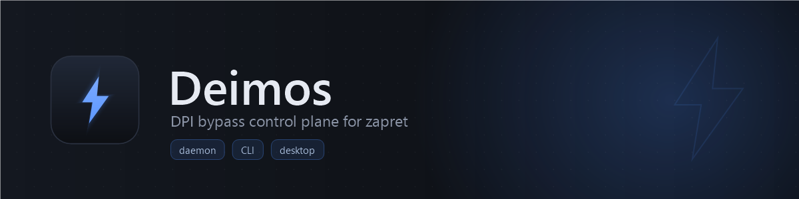

<p align="center">
  <a href="../../README.md">🇬🇧 English</a> &nbsp;·&nbsp; <b>🇷🇺 Русский</b>
</p>

<p align="center">
  
</p>

<p align="center">
  <a href="https://github.com/ToshiNamura/Deimos/actions/workflows/ci.yml"></a>
  <a href="../../LICENSE"></a>
  <a href="../../CMakeLists.txt"></a>
</p>

# Deimos

Deimos — это кроссплатформенная панель управления обходом DPI поверх
[zapret](https://github.com/bol-van/zapret) и [zapret2](https://github.com/bol-van/zapret2).

Задача разделена на две программы:

| Программа | Роль |
| --- | --- |
| `deimosd` | Демон без интерфейса. Владеет процессами zapret, применяет профили и обслуживает API управления. Работает локально, на роутере или на VPS. |
| `deimos` | Единственный клиентский бинарник: без аргументов открывает настольный интерфейс, а с командой ведёт себя как полноценный клиент командной строки. |

Демон и клиент общаются по обычному HTTP + JSON с bearer-токеном, поэтому один и тот же
интерфейс и CLI управляют демоном на `127.0.0.1` и демоном на удалённом сервере.

## Возможности

- **Профили вместо флагов.** Профиль описывает фильтры, режимы десинхронизации, позиции
  разделения, обман (fooling), поддельные полезные данные, списки хостов и ipsets.
  `deimos profiles preview` печатает точную командную строку zapret до того, как что-либо
  будет запущено.
- **zapret под присмотром.** Каждый запуск — дочерний процесс с перехваченным выводом,
  политикой перезапуска (`engine.maxRestarts`, `engine.restartBackoffMs`) и
  гарантированной очисткой: job objects Windows, группы процессов POSIX.
- **Один API, два фронтенда.** GUI и CLI — это один и тот же бинарник, работающий с одними
  и теми же REST-эндпоинтами, поэтому оба действуют и локально, и в связке с удалённым
  демоном.
- **Сначала loopback и токен.** Демон занимает `127.0.0.1`, сравнивает bearer-токены за
  постоянное время, отказывается слушать удалённые адреса без аутентификации и
  поддерживает необязательный TLS.
- **Сервисы — полноправные объекты.** Один флаг устанавливает службу Windows, unit systemd
  или plist launchd.
- **Малый след без интерфейса.** Пресет `daemon-only` собирает единственный статически
  слинкованный `deimosd` для серверов, роутеров и контейнеров.
- **Английский и русский из коробки.** Интерфейс, CLI, справка, журналы демона и каждое
  диагностическое сообщение валидации переведены, а интерфейс меняет язык без перезапуска.
  См. [Локализация](./localization.md).

## Состояние

Ранняя стадия разработки. Архитектура, API и формат конфигурации уже на месте; интерфейс и
CLI работоспособны, но продолжают развиваться.

## План развития

Работа планируется по [вехам](https://github.com/ToshiNamura/Deimos/milestones):

| Веха | Тема |
| --- | --- |
| [v0.1.1](https://github.com/ToshiNamura/Deimos/milestone/2) | Патч надёжности: валидация только для чтения, семантика HTTP, наблюдаемые состояния движка |
| [v0.2.0](https://github.com/ToshiNamura/Deimos/milestone/3) | Паритет стратегий: каждый флаг, который используют реальные стратегии zapret и Flowseal, схема v2 |
| [v0.3.0](https://github.com/ToshiNamura/Deimos/milestone/4) | Пресеты, управляемые списки и проверяемые обновления списков |
| [v0.4.0](https://github.com/ToshiNamura/Deimos/milestone/5) | Проверки целей, тестер стратегий, диагностика, автоматическое переключение при отказе |
| [v1.0.0](https://github.com/ToshiNamura/Deimos/milestone/6) | Зрелость настольного приложения: трей, первичная настройка, локализация, установщики |
| [Бэклог](https://github.com/ToshiNamura/Deimos/milestone/1) | zapret2, OpenWrt, маршрутизация по процессам, статистика трафика |

Задачи с меткой [`good first issue`](https://github.com/ToshiNamura/Deimos/labels/good%20first%20issue)
рассчитаны на первый вклад. Всё, что не запланировано, лежит в бэклоге, поэтому порядок работ
можно изменить, открыв запрос новой функции.

## Документация

- [Архитектура](./architecture.md) — компоненты, поток данных, модель потоков, безопасность
- [API демона](./daemon-api.md) — справочник по REST с примерами
- [Стратегии](./strategies.md) — как профили отображаются на аргументы zapret
- [Сборка](./building.md) — наборы инструментов, пресеты, упаковка
- [Развёртывание](./deployment.md) — службы в Windows, Linux и macOS
- [Локализация](./localization.md) — языки, каталог сообщений, добавление строк

## Быстрый старт

### Собрать всё

Пресеты используют Ninja, поэтому запускать их нужно из оболочки разработчика (`vcvars64.bat`
в Windows, обычная оболочка с компилятором в Linux и macOS):

```powershell
cmake --preset x64-release
cmake --build --preset x64-release
```

```bash
cmake --preset linux-release
cmake --build --preset linux-release
```

### Собрать только демон (серверы, роутеры, машины без интерфейса)

```bash
cmake --preset daemon-only
cmake --build --preset daemon-only
```

`daemon-only` выдаёт единственный бинарник `deimosd` со статической средой выполнения C++ и
без зависимостей от UI, CLI и тестов. Эквивалентный переключатель — `-DDEIMOS_SERVER_ONLY=ON`.

### Запустить демон

```bash
deimosd --generate-token        # writes <state dir>/token, prints it once
deimosd --config /etc/deimos/deimos.json
```

### Открыть настольный интерфейс

```bash
deimos --gui
```

### Использовать командную строку

```bash
export DEIMOS_TOKEN=$(cat ~/.local/state/deimos/token)
deimos status
deimos profiles list
deimos start --profile tls-split
deimos logs --limit 50
deimos doctor
```

## Клиентский бинарник

`deimos` — единственный консольный бинарник, который выполняет обе роли:

| Вызов | Поведение |
| --- | --- |
| `deimos <command> ...` | клиент командной строки, коды возврата и конвейеры работают как обычно |
| `deimos --gui` | настольный интерфейс |
| `deimos` из терминала | печатает справку |
| `deimos` из Explorer или ярлыка на рабочем столе | настольный интерфейс |

Клиенты хранят свои эндпоинты в `cli.json` / `ui.json` рядом с конфигурацией, поэтому
пользователь GUI может управлять несколькими демонами, а CLI выбирает тот же из них командой
`endpoints use`.

## Требования

- Windows 10 или новее, Linux или macOS
- CMake 3.25 или новее
- Компилятор C++20 (MSVC 19.4x, GCC 12+, Clang 15+)
- Бинарники zapret или zapret2 для той платформы, чей трафик нужно изменять
- Драйвер OpenGL 3.2 для GUI (демон и CLI работают без интерфейса)

Сторонние зависимости (nlohmann/json, cpp-httplib, GLFW, Dear ImGui, Catch2) скачиваются
автоматически средствами CMake, если они ещё не установлены.

## Участие в разработке

Сообщения об ошибках и пул-реквесты приветствуются. [CONTRIBUTING.md](./CONTRIBUTING.md)
описывает требования к сборке, тестам и стилю; в [CHANGELOG.md](../../CHANGELOG.md) записано, что
изменилось.

## Безопасность

Сообщайте об уязвимостях приватно, как описано в [SECURITY.md](./SECURITY.md), и никогда в
публичном issue.

## Фирменные материалы

Логотип, иконка и баннер лежат в [assets/](../../assets): `logo.png` и `icon.png` имеют размер
283x300, `background.png` — баннер 1200x300, используемый вверху этой страницы.
`assets/generate-assets.ps1` перерисовывает все три файла через GDI+ в Windows, поэтому
графика остаётся воспроизводимой из исходников, а не непрозрачным бинарным блоком.

## Лицензия

MIT, см. [LICENSE](../../LICENSE). Сторонние компоненты перечислены в
[THIRD_PARTY_NOTICES.md](../../THIRD_PARTY_NOTICES.md). zapret — отдельный проект со своей
лицензией, он никогда не поставляется в комплекте.

---

Перевод файла [README.md](../../README.md). Синхронизировано с коммитом c679559.
